<!--
amharic-writer: an agent skill for writing, translating, localizing and proofreading Amharic (አማርኛ)
so it reads as natural Amharic rather than translated English. Works with Claude Code, claude.ai and
other agents that support the Agent Skills format.
-->



<h1 align="center">amharic-writer</h1>

<p align="center">
  <b>Natural, suitably polite Amharic from your AI agent.</b><br />
  Writing, translation, app strings, proofreading and Ethiopian-calendar dates, for <a href="https://claude.com/product/claude-code">Claude Code</a>, claude.ai and other agents.
</p>

<p align="center">
  <a href="#install">Install</a> ·
  <a href="#see-it-work">See it work</a> ·
  <a href="#without-and-with-the-skill">Without and with</a> ·
  <a href="#what-it-covers">What it covers</a> ·
  <a href="#results">Results</a> ·
  <a href="#faq">FAQ</a>
</p>

<p align="center">
  <a href="https://github.com/Mr-MaNia7/amharic-writer/releases"></a>
  <a href="LICENSE"></a>
  <a href="https://agentskills.io"></a>
  <a href="BENCHMARKS.md"></a>
  <a href="https://github.com/Mr-MaNia7/amharic-writer/stargazers"></a>
</p>

**Models often write Amharic that sounds translated.** They copy English word order and articles, mix polite and familiar forms, put a space before ።, and give dates and times that Ethiopian readers will misread. amharic-writer is a skill that teaches the agent how Amharic actually works:

- **Register.** Polite forms (እርስዎ, ይደውሉ) for customers and elders, familiar forms for family, never mixed. Feminine agreement carries through every verb, pronoun and adjective.
- **Grammar that English hides.** Object ‑ን, the definite ‑ው only when the reader knows which one is meant, and prepositions that move onto the verb (ላክሁላቸው).
- **Punctuation.** ። ፣ ፤ ፦ with no space before them, and no `::` in place of ።.
- **Ethiopian dates and time.** Dates converted with code, not guessed (ዓርብ ጥቅምት 28 ቀን 2018 ዓ.ም.), and the Ethiopian clock (ሰኞ ከጠዋቱ 3:00 ሰዓት is 9:00 a.m.).
- **Texts with an official wording.** It won't invent a translation of a law or scripture. It leaves a marked place for the published one.

You don't have to name the skill. Ask for Amharic the way you normally would.

## See it work



The notice is the output of a test run. The tool steps are shortened.

## Without and with the skill



Same model, same request. The full outputs are in [BENCHMARKS.md](BENCHMARKS.md#examples).

## Install

```sh
npx skills add Mr-MaNia7/amharic-writer
```

This uses the open [`skills`](https://github.com/vercel-labs/skills) CLI and works with Claude Code, Codex, Cursor and other agents that read Agent Skills.

<details>
<summary><b>Claude Code plugin</b></summary>
<br />

```
/plugin marketplace add Mr-MaNia7/amharic-writer
/plugin install amharic-writer@amharic-writer
```

</details>

<details>
<summary><b>claude.ai</b></summary>
<br />

1. Download `amharic-writer.zip` from the [latest release](https://github.com/Mr-MaNia7/amharic-writer/releases/latest).
2. In claude.ai, open Settings → Capabilities → Skills and upload the zip.

</details>

<details>
<summary><b>By hand</b></summary>
<br />

Copy `skills/amharic-writer/` into `~/.claude/skills/` to use it in every project, or into a project's `.claude/skills/` for that project only.

```sh
git clone https://github.com/Mr-MaNia7/amharic-writer
cp -r amharic-writer/skills/amharic-writer ~/.claude/skills/
```

</details>

Then try:

```
translate this notice into Amharic for our members in Addis: "Our office will be closed on Friday, November 7, 2025. Services resume on Monday at 9:00 AM."
```

## What it covers

| Task | What the skill adds |
|---|---|
| Messages, posts, notices | The right register for the reader, natural word order, Ethiopic punctuation |
| Translation to and from Amharic | Meaning over word-for-word; no English articles or calques carried over |
| App and website strings | Polite button labels (ያስቀምጡ), placeholders kept exactly, room for wider Fidel letters |
| Proofreading | Fixes real errors, leaves valid spelling variants (ሥራ / ስራ) alone, lists each change |
| Dates and times | Ethiopian calendar converted with code, Ethiopian clock, both calendars when readers need them |

The core skill is about 70 lines, roughly 2,500 tokens for a short message. Four reference files, on interface strings, dates and numbers, grammar and style, load only when a task needs them.

It stays out of the way for Tigrinya and other Ethiopic-script languages, for questions about Amharic answered in English, and for English text that only mentions Ethiopia.

## Results

| | Result |
|---|---|
| Output checks, final version (11 tasks × 3 runs) | **349 / 351** |
| Earlier comparison: without the skill → with it | 154 / 195 → **191 / 195** |
| Activation: right call on when to switch on | **86 / 86** |

Tested on Claude Sonnet 5.5 with free, repeatable pattern checks and no AI grader. [BENCHMARKS.md](BENCHMARKS.md) has the method, every task, the examples and what the numbers don't show.

## FAQ

<details>
<summary><b>Which models does it work with?</b></summary>
<br />

It was tested on Claude Sonnet 5.5. The skill is plain instructions, so other capable models should benefit too, but Opus and other vendors' models haven't been tested yet.

</details>

<details>
<summary><b>Will it change my text when I ask for proofreading?</b></summary>
<br />

Only real errors. Valid spelling variants such as ሥራ and ስራ are left as you wrote them, and the reply lists each change with its reason.

</details>

<details>
<summary><b>Does it work for Tigrinya?</b></summary>
<br />

No. Tigrinya shares the Fidel script but is a different language, and the skill is written to stay off for it.

</details>

<details>
<summary><b>Why the Ethiopian calendar and clock?</b></summary>
<br />

Many readers in Ethiopia use them day to day. "Friday, November 7, 2025" is ዓርብ ጥቅምት 28 ቀን 2018 ዓ.ም., and 9:00 a.m. is ከጠዋቱ 3 ሰዓት. A bare "9:00" in Amharic text is ambiguous, so the skill says which clock it means or gives both.

</details>

<details>
<summary><b>The skill got something wrong. How do I report it?</b></summary>
<br />

Open an issue with the sentence, what you'd write instead, and why. Corrections from Amharic speakers are the most useful contribution this project can get.

</details>

## Limits

This is version 0.1.

- Tested on Claude Sonnet only.
- The tests were written by the author with Claude's help. The checks catch specific errors; they can't tell a fluent sentence from a stiff one. The author reviewed the Amharic examples in the skill, but no independent Amharic speakers have reviewed its output yet.
- A few rules are still open, such as how formally to refer to a teacher in a casual family note.

## Repository

```
skills/amharic-writer/   the skill: SKILL.md and references/
evals/                   output tests for `claude plugin eval`
trigger-evals/           activation tests
assets/readme/           the README images and the script that builds them
.claude-plugin/          plugin and marketplace manifests
```

To run the tests, see [evals/README.md](evals/README.md).

## License and credits

MIT. See [LICENSE](LICENSE).

The README images embed subsets of [Noto Serif Ethiopic and Noto Sans Ethiopic](https://notofonts.github.io/ethiopic/), [Literata](https://github.com/googlefonts/literata) and [Source Code Pro](https://github.com/adobe-fonts/source-code-pro), all under the SIL Open Font License.

<p align="center">
  Made by <a href="https://github.com/Mr-MaNia7">Abdulkarim Getachew</a> · <a href="https://blog.abdulkarimg.com">blog.abdulkarimg.com</a>
</p>
